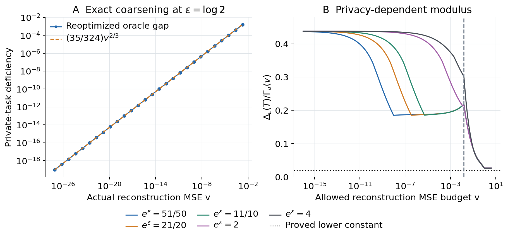

# Optimal Private Representations

Reference algorithms and reproducible experiments for learning randomized representations for bounded regression under differential privacy.

The repository studies a finite public input alphabet and a target in $[0,1]$ under squared loss. A learning algorithm fits a randomized representation channel and a decoder from labeled records. Two privacy constraints protect different objects: central differential privacy protects complete training records, and local differential privacy protects each fresh input released through the fitted channel.

The package contains the learning algorithms, six comparison methods, exact population-oracle calculations, synthetic experiment protocols, recorded measurements, and commands for reproducing the analyses. The documentation defines the statistical problem and experimental procedures without requiring a separate manuscript.

## Installation

Use Python 3.12 in a virtual environment. From the repository root:

```bash
python -m venv .venv
source .venv/bin/activate
python -m pip install -r requirements-lock.txt
python -m pip install --no-deps -e .
```

On Windows, activate the environment with `.venv\Scripts\activate`. The recorded experiment environment used Python 3.12.14, NumPy 2.3.5, SciPy 1.17.0, and Matplotlib 3.10.8. The pinned dependency file records the numerical environment; runtime measurements remain dependent on hardware and system load.

## Reproduce the results

The command-line interface separates verification, analysis of recorded measurements, and new simulation:

```bash
opr smoke
opr validate
opr reproduce --output-dir outputs/reference-reproduction
```

`smoke` exercises the installed learner and its principal numerical invariants. `validate` checks the frozen reference artifacts. `reproduce` rebuilds the summaries, figures, and tables from the recorded measurements and recomputes the exact finite-law diagnostics. It does not rerun the full learning simulation.

To generate a new complete learning run, use:

```bash
opr simulate --replicates 256 --output-dir outputs/full-simulation
opr summarize --data-dir outputs/full-simulation/data --output-dir outputs/full-analysis
```

The complete study fits 76,800 models on 12,800 independently generated training samples. `summarize` analyzes a newly generated learning run and writes its summaries and learning figures separately. Diagnostic replays and serial runtime benchmarks have separate commands. The [reproduction guide](docs/reproducibility.md) specifies their order, expected outputs, comparison criteria, and computational scope. Use a fresh output directory for a new run; frozen artifacts in `data/reference/` remain unchanged.

## Scientific scope

Let $H\in\{0,\ldots,d-1\}$ denote the output of a public encoder fixed independently of the fitting sample, and let $Y\in[0,1]$. The learner returns a channel $Q(z\mid h)$ and a decoder $g(z)$. Its population risk is

$$
R_P(Q,g)=\mathbb E_{(H,Y)\sim P}\!\left[\sum_z Q(z\mid H)(Y-g(z))^2\right].
$$

The fitted model has pure central privacy budget $\alpha$ under replacement of one complete labeled record. For every realized fitted model, the query channel satisfies

$$
Q(z\mid h)\leq e^\varepsilon Q(z\mid h')
\quad\text{for all }h,h',z.
$$

The local constraint includes declared input states absent from the fitting sample. The released private representation is a randomized output $Z$. Deterministic bin assignments and conditional prediction expectations are evaluation quantities, and do not constitute private releases of a confidential query input.

The main learner uses a fixed sample split, a private pilot ordering, a private calibration histogram and target mean, and exact dynamic programming over ordered partitions. The public API uses a conservative bound on the number of outputs. The experiment implementation preserves the unrestricted output-count search used to produce the recorded measurements. Both implementations and their relationship are described in the [methods guide](docs/methods.md).

The implemented learner accepts $0\leq\varepsilon\leq\log 4$ and finite $\alpha\geq0$. The matching finite-alphabet minimax statement uses $d\geq4$. The numerical code is a research implementation in floating-point arithmetic; it does not certify machine-level differential privacy. Fixed public seeds are used for reproducible synthetic experiments.

## Python example

This example generates a synthetic bounded-regression problem, fits the capped learner, and samples a private representation for each query state. The fixed seeds make the example reproducible.

```python
import numpy as np
from optimal_private_representations import fit_finite_private_task_learner

data_rng = np.random.default_rng(7)
conditional_means = np.array([0.05, 0.35, 0.65, 0.95])
states = data_rng.integers(0, 4, size=1024)
targets = data_rng.binomial(1, conditional_means[states]).astype(float)

model = fit_finite_private_task_learner(
    states,
    targets,
    cells=4,
    epsilon_query=np.log(2),
    alpha_train=1.0,
    rng=np.random.default_rng(11),
)

query_states = np.array([0, 1, 2, 3])
representations = model.sample_representations(
    query_states, rng=np.random.default_rng(13)
)
predictions = model.decode(representations)
```

`model.predict` combines sampling and decoding. `model.probabilities` and `model.expected_prediction` support analytic evaluation; their values should not be treated as randomized releases of the supplied query states. The local privacy budget applies to each release; repeated releases concerning the same confidential input require composition.

## Experiments and data

The experiments cover population representation loss, finite-sample learning, ordering and mean-calibration ablations, local alternatives near a change of optimal partition, and runtime and allocation measurements.

| Study | Reference material | Evaluation |
|---|---|---|
| Population coarsening | 930 law–statistic–budget cases | Exact rational oracles and independent floating-point checks |
| Learning and ablations | 50 configurations, 256 replicates, six methods | Analytic population risk, pointwise Monte Carlo intervals, paired comparisons |
| Output-count diagnostic | Six privacy settings for a four-state law | Exact optimal risks and minimum optimal output counts |
| Local-alternative decomposition | 15,360 replays of existing fits | Channel excess and decoder-estimation error |
| Runtime and memory | Serial uncapped implementations | Nine timed repetitions after warm-up; separate allocation tracing |

All reference data are synthetic. The saved learning CSV contains fit-level measurements; individual simulated training records are regenerated from the documented laws and seeds. Population query and target randomness are integrated analytically. The intervals quantify Monte Carlo uncertainty for the specified laws; they are pointwise intervals, not simultaneous confidence bands. These experiments do not estimate a minimax supremum.



The [experiment protocol](docs/experiments.md) defines the laws, configuration grid, baselines, seed construction, uncertainty calculations, and interpretation. The [data dictionary](docs/data_dictionary.md) defines the stored fields and artifact relationships.

## Repository organization

| Location | Purpose |
|---|---|
| `src/optimal_private_representations/` | Importable learning algorithms and command-line workflows |
| `data/reference/` | Frozen numerical measurements, exact-oracle references, protocols, and metadata |
| `results/reference/` | Reference figures and tables derived from the recorded measurements |
| `docs/` | Methods, experiment design, data schemas, and reproduction instructions |
| `tests/` | Focused numerical and workflow verification |
| `outputs/` | Local regenerated artifacts; excluded from version control |

## Citation and maintenance

The source code, reference artifacts, and reproduction instructions are published at [MohitKumarRostock/optimal-private-representations](https://github.com/MohitKumarRostock/optimal-private-representations). The initial software version is **0.1.0**. Its [immutable reference snapshot](https://github.com/MohitKumarRostock/optimal-private-representations/tree/307c586f4be26fa7c53602b7742975b7f74279d8) identifies the exact implementation and numerical artifacts.

See [CITING.md](CITING.md) for a software citation and instructions for identifying the exact revision used in an experiment. A moving branch name alone is insufficient to identify an immutable scientific result.

The [maintenance guide](docs/maintenance.md) explains how changes to algorithms, protocols, and reference artifacts are reviewed. Citation attribution and distribution-license metadata will be completed by the maintainer; this initial package does not assign an unconfirmed author list or license.
